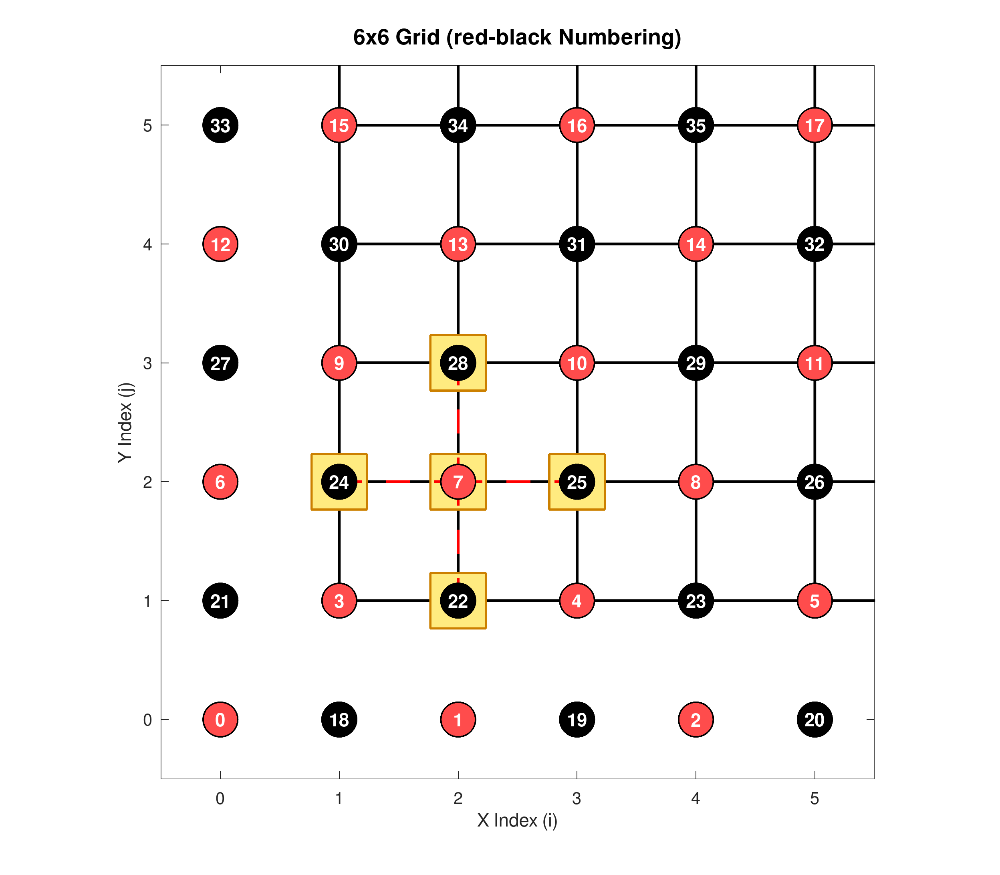

# Parallelization of a 2D Convection-Diffusion Solver

In this exercise, you are given a sequential simulation code and convert it
step-by-step into an efficient parallel program using MPI.
Details of the parallelization approach were discussed in Lecture 4, please consult the slides as well.

---

## The sequential program

### Problem Description

This exercise focuses on solving the steady, two-dimensional **Convection-Diffusion Equation**, a fundamental partial differential equation (PDE) that describes diffusion of a tracer in a stationary flow field. The equation is given by:

```math
c \cdot \frac{\partial u}{\partial x} + d \cdot \frac{\partial u}{\partial y} 
   - \underbrace{\left(\frac{\partial^2 u}{\partial x^2} + \frac{\partial^2 u}{\partial y^2}\right)}_{\text{Laplacian } (\nabla^2 u)} 
   = \underbrace{F(x,y)}_{\text{source term}}
```

where:

- $u(x, y)$ represents the tracer concentration at position $(x, y)$,
- $(c, d)$ are the constant flow velocities in the $x$ and $y$ directions,
- $F(x,y)$ is a source term simulating injection of the tracer.

The domain is the unit square, $\Omega = [0, L_x] \times [0, L_y]$ ($L_x = L_y = 1$),
and the system is completed with homogeneous Dirichlet boundary conditions in the $y$-direction, and periodic boundary conditions in the $x$-direction:

- Homogeneous Dirichlet (top and bottom walls):
  $$u(x, 0) = u(x, L_y) = 0$$
- Periodic boundary conditions (left and right boundaries):
  $$u(0, y) = u(L_x, y)$$


### Numerical Solution

To solve the equation numerically, we employ the **Finite Difference Method (FDM)** using second-order central differences for
the diffusion term (second partial derivatives $\frac{\partial^2}{\partial x^2}, \frac{\partial^2}{\partial y^2}$), and a first-order upwind scheme for the advection term (first partial derivatives $\frac{\partial}{\partial x}, \frac{\partial}{\partial y}$).

### Spatial Discretization

The domain is discretized using a uniform Cartesian grid with spatial step sizes $\Delta x$ and $\Delta y$:

- $x_i = i \cdot \Delta x$ for $i = 0, 1, \dots, n_x - 1$
- $y_j = j \cdot \Delta y$ for $j = 0, 1, \dots, n_y - 1$

Using central differences for the spatial second derivatives, the spatial Laplacian $\nabla^2 u$ is approximated at grid point $(i, j)$ by:

$$\nabla^2 u_{i,j} \approx \frac{u_{i+1,j} - 2u_{i,j} + u_{i-1,j}}{\Delta x^2} + \frac{u_{i,j+1} - 2u_{i,j} + u_{i,j-1}}{\Delta y^2}$$

Depending on the sign of the convection parameter $c$, we use the following **upwind scheme** for the first derivative:

$$ c \cdot \frac{\partial u}{\partial x} \approx \left \{ \begin{array}{ll}
c \frac{u_{i,j} - u_{i-1,j}}{\Delta x} & \text{if } c \ge 0 \\
c \frac{u_{i+1,j} - u_{i,j}}{\Delta x} & \text{if } c < 0 \end{array} \right.
$$
(and analogously for $d \cdot \frac{\partial u}{\partial y}$ in the $y$-direction). This scheme ensures the discretized algebraic system is diagonally dominant and stable.

---

### Structure of the Sequential Program

The reference sequential implementation solves the steady-state equation using an iterative in-place Gauss-Seidel relaxation scheme:

```
┌─────────────────────────────────────────────────────────┐
│                    Initialization                       │
│  - Parse CLI arguments (nx, ny, cx, cy, tol, max_iters) │
│  - Allocate solution grid u and source grid f           │
│  - Initialize initial guess u = 0 (init_sol)            │
│  - Evaluate RHS Gaussian source peak f (set_rhs)        │
└────────────────────────────┬────────────────────────────┘
                             │
                             ▼
┌─────────────────────────────────────────────────────────┐
│                Gauss-Seidel Iteration Loop              │
│       while (max_diff > tol && iter < max_iters) do     │
│                                                         │
│   ┌─────────────────────────────────────────────────┐   │
│   │   In-place 5-Point Upwind Stencil Sweep         │   │
│   │   for j = 1 to ny - 2 do                        │   │
│   │       for i = 0 to nx - 2 do                    │   │
│   │           Compute u_new from stencil & f        │   │
│   │           Track max change: |u_new - u[j][i]|   │   │
│   │           Update in-place: u[j][i] = u_new      │   │
│   └─────────────────────────────────────────────────┘   │
│                                                         │
│   ┌─────────────────────────────────────────────────┐   │
│   │   Boundary Condition Enforcement                │   │
│   │   - Dirichlet at y = 0 and y = ny - 1           │   │
│   │   - Periodic copy: u[j][nx - 1] = u[j][0]       │   │
│   └─────────────────────────────────────────────────┘   │
└────────────────────────────┬────────────────────────────┘
                             │
                             ▼
┌─────────────────────────────────────────────────────────┐
│                Diagnostics & Finalization               │
│  - Compute & print canary indicators (print_canaries)   │
│    (Flux balance, energy balance, L2 and H1 norms)      │
│  - Export grayscale PGM images (rhs.pgm, solution.pgm)  │
│  - Free allocated grid memory (free_grid)               │
└─────────────────────────────────────────────────────────┘
```

### Code Structure:
1. **[`header.h`](header.h)**: Defines simulation data structures ([`Params`](header.h#L5-L15) and [`Grid`](header.h#L18-L23)) and function prototypes.
2. **[`util.c`](util.c)**: Contains utility routines for 2D contiguous grid allocation ([`allocate_grid`](util.c#L7-L20)), cleanup ([`free_grid`](util.c#L22-L34)), and PGM grayscale image export ([`write_pgm`](util.c#L36-L74)).
3. **[`pde_solver.c`](pde_solver.c)**: Contains the main simulation driver ([`main`](pde_solver.c#L12-L56)), argument parsing ([`parse_args`](pde_solver.c#L61-L90)), solution/RHS setup ([`init_sol`](pde_solver.c#L102-L111), [`set_rhs`](pde_solver.c#L114-L126)), boundary condition enforcement ([`set_boundaries`](pde_solver.c#L312-L326)), Gauss-Seidel solver ([`solve_gauss_seidel`](pde_solver.c#L329-L378)), and canary diagnostics ([`print_canaries`](pde_solver.c#L380-L441)).
4. **[`Makefile`](Makefile)**: Compiles the program using `mpicc -O3` into the executable `pde_solver.x`.

---

## Your task: Step-by-step MPI parallelization

While performing these steps, keep a backup of each working program code, either via ``git`` commits or by copying each version to a separate file
for later use.

### 1. 1D-partitioning

Implement a one-dimensional partitioning of the domain, where every MPI process `p`
owns a _subdomain_ $\Omega_p = [0, L_x] \times [y_0^{p}, y_1^{p}]$.

- Extend the data structure ``Grid`` with additional variables you may need.
- Use the top and bottom layer (which hold the Dirichlet boundary conditions in the sequential case) as "ghost layers" 
  (**hint:** You can add the exchange of ghost nodes among processes to ``set_boundaries``).
- Use a global reduction to parallelize the norm calculations in `solve_gauss_seidel`` and the integrals in ``print_canaries``. 
- In order to get the output PGM image correctly saved, gather it into a separate Grid object on MPI rank 0 before calling ``write_pgm``
  (Note that not all ranks may have the same number of elements! There are special collective variants for this case in MPI).

Verify that your program computes the correct solution
for a varying number of MPI processes and grid sizes. Is the convergence behavior affected?

### 2. Red-Black ordering

To make the solver (Gau\ss-Seidel) behave consistently, we have to change the order of updates such that
it is independent of the number of processes and domain decomposition strategy. Implement red-black Gau\ss-Seidel, where
the sweep is split into two, one for the red nodes, and one for the black:



Implement red-black Gau\ss-Seidel. Note that you have to exchange nodes in two steps as well, and that there is a 'hole'
between the nodes of the same color (a _stride_ of 2). You can do this in two ways:

- (i) Manually copy the values to/from separate send/receive buffers,
- or (ii) use the ``MPI_Type_vector`` function to define strided data types.

While the second approach looks more complicated at first, it is cleaner and more general.

### 3. SOR method

Accelerate the resulting red/black Gau\ss-Seidel by _successive over-relaxation_ (SOR). 
In matrix/vector notation, the SOR update formula is given by:
$$u_i^{(k+1)} = (1 - \beta) u_i^{(k)} + \frac{\beta}{a_{ii}} \left( f_i - \sum_{j < i} a_{ij} u_j^{(k+1)} - \sum_{j > i} a_{ij} u_j^{(k)} \right).$$
Add the parameter beta as a command-line option ``-b`` to your program, including a check that $1\beta\<2$,
and experiment to find a value that gives fast convergence.

### 4. 2D partitioning

Generalize your MPI program to use a two-dimensional Cartesian domain decomposition. Ignore the output PBM image for now.

- You will now need to exchange the ghost layers (halo elements) in both $x-$ and $y-$direction. Make sure the global
  boundary conditions are preserved!
- You can further extend the Grid struct to hold information about the domain decomposition
- There are again two ways to tackle this problem: (i) by manually determining a 2D processor rank $(p_x, p_y)$,
  or (ii) by using the ``MPI_Cart_*`` family of functions, which will lead to a portable mapping of your program to the underlying hardware topology.

### 5. Advanced MPI usage

Make sure your program runs correctly for a variety of combinations of number of processes and grid sizes
before continuing. For the following tasks, you may want to consult an AI agent to help with the syntactic
and semantic details, but make sure to also look at the ``man`` pages to check that you understand what the code
does and that the generated code is correctly applied in your specific application.

**5.1** If you haven't done so, use ``MPI_Cart_create`` to supply information about the cartesian partitioning to MPI
   (it will create a new communicator that you should use instead of ``MPI_COMM_WORLD``), and use ``MPI_Cart_shift``
   to determine the communication partners/neighbors.

**5.2** With the general two-dimensional partitioning in place, it is now time to also get the output PBM image right. Unfortunately,
with the 2D decomposition it is no longer straight-forward to ``gather`` the solution on a single process because the rows from different
processes must be interleaved in the global array. Use the advanced MPI function ``MPI_Type_create_subarray`` to define a data type representing
the 2D subdomain as it would live in the global 2D array, and use it to fix your gathering of the final solution before ``write-pbm``.

**5.3** **Overlapping communication and computation.** Only the update of grid locations next to the ghost layer depend on the values received from the 
neighboring process, e.g., ``u[1][i], u[nx-2][i]``. Use non-blocking point-to-point calls ``MPI_Isend``, ``MPI_Irecv`` to do the ghost-node exchange,
and update _all but the outer layer_ of ``u`` before posting the ``MPI_Waitall`` to conclude the communication. Then update the outer layer before going to the next color/iteration.

### 6. Sequential performance and Roofline model

- Count the number of flops and the amount data transferred (load + store) in one iteration of the SOR loop under the assumption that
$u_{i-1,j}, u_{i,j}$ and $u_{i,j-1}$ still reside in the cache in iteration $i$.
What is the computational intensity $I_c$ (aka code balance)?
- Use the job script `node_speed.slurm` to measure the "machine balance" $I_M$ for a single core. Use the ``daxpy`` performance
for a tiny data set that fits in the L1 cache as $R_{peak}$ and for a large dataset (that resides in RAM) for the memory bandwidth.
Is this solver compute- or memory-bound?
- Create the iconic roofline plot for a single core, and mark the measured performance of your sequential standard and red/black SOR variants in it
(diagnostic roofline modelling, see Lecture 5).
- The script also measures ``daxpy`` performance for an increasing number of cores on a ``compute-p2`` node.
Create a plot of memory bandwidth $B$ against number of cores $P$.

### 7. Scaling experiments

Run your different variants (1D/2D/overlapped) of red/black SOR in both a strong and weak scaling experiment
(for a fixed grid size and a grid size growing linearly with the number of processes) on DelftBlue using up to 64 processes.

- Use a complete "compute-p2" node (see ``node_speed.slurm``)
- Compare against the **fastest sequential version**
- Strong scaling: Use $n_x=n_y=10,000$
- Weak scaling: Use approximately 1.5 million eleemnts per process (e.g., $128\times 128$). 
- Create a slurm jobscript that requests,  ``--ntasks=64 --cpus-per-task=1 --mem-per-cpu=3.8GB``, and start your program
for the different number of processes using, e.g., 

```bash
srun --ntasks=1 ./pde_solver.x
srun --ntasks=2 ./pde_solver.x
srun --ntasks=4 ./pde_solver.x
...
```

so that all experiments use the same cores on DelftBlue.

- Limit the number of iterations to a relatively small, fixed amount (e.g., 1000)
  so that runtime stays reasonable and is representative of the time per iteration (not the fact that more iterations are needed for solving
  on a larger grid).
- Distill the runtime into two plots. Tip: the Linux command `grep` can extract all occurences of a line from a file, e.g.:

```bash
grep -e Grid -e Time pde_solver.out
```

Comment on sub-/superlinear speed-up. Which variant shines in which situation?
Try to explain your observations.

### 7. (OPTIONAL!) Vibe-coding challenge

What is the communication-to-computation ratio with Cartesian partitioning vs. the skew (or "diamond") partitioning briefly discussed in Lecture 4?
Try to get your AI agent to generate an SOR solver that

- redistributes ``u`` and ``f`` to a skew partitioned grid
- solves the problem using the same red/black SOR method (with much less communication!)
- redistributes ``u`` back to the original partitioning for post-processing.

Put this into a single function that can be called alternatively to ``solve-gauss-seidel``.
Make sure it produces correct results (convergence should be the same!), and run your benchmark
experiments with this version, extending your plots by another line.
